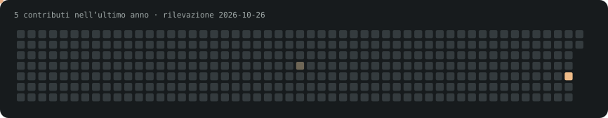

<picture>
  <source media="(max-width: 600px)" srcset="assets/github/terminal-dashboard-mobile.svg">
  
</picture>

### `bernindo@github ~ $ ./edbrix.sh`

**[Esplora EdBrix Studios](https://edbrixstudios.vercel.app)**

Il tour anima due schermate del sito pubblico. Matrice ed equalizzatore sono decorativi; i dati GitHub reali sono riportati sotto.

Statistiche GitHub reali

<picture>
  <source media="(max-width: 600px)" srcset="assets/github/terminal-statistics-mobile.svg">
  
</picture>

Snake dei contributi

Dati, attività e fonti

Rilevazione: **2026-10-22**. Il calendario mostra i contributi pubblicamente visibili; non rappresenta automaticamente tutta l’attività privata.

Streak, giorni attivi, giorno migliore e media sono calcolati sugli ultimi 365 giorni. La streak attuale include ieri se oggi non ci sono ancora contributi. Il grafico mostra gli ultimi 12 mesi di calendario; il mese corrente è parziale. I valori zero restano zero.

Nessun evento pubblico recente restituito da GitHub.

- **EdBrix Studios:** sito raggiungibile (HTTP 200).

I controlli HTTP misurano la raggiungibilità, non il funzionamento interno dei prodotti.

[Dati e fonti](data/profile.json) · [GitHub](https://github.com/bernindo)

