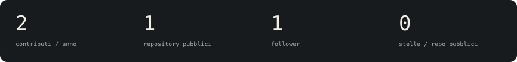

<picture>
  <source media="(prefers-color-scheme: light)" srcset="assets/github/header-light.svg">
  
</picture>

### Progetti selezionati

**[FidAvanti / fidcard](https://www.fidavanti.it)** — Carte fedeltà digitali: iscrizione con QR, punti e premi.

**[EdBrix Studios](https://edbrixstudios.vercel.app)** — Strategia, design e sviluppo: il sito dello studio.

Le sequenze mostrano schermate dei siti pubblici, non registrazioni di operazioni nelle applicazioni.

### GitHub, in numeri

Snake dei contributi

Attività, stato dei siti e fonti

Nessun evento pubblico recente restituito da GitHub.

- **FidAvanti:** HTTP 200, sito raggiungibile (2026-10-22).
- **EdBrix Studios:** HTTP 200, sito raggiungibile (2026-10-22).

I controlli HTTP indicano la raggiungibilità al momento della rilevazione, non l’esito di test o CI. Dati pubblici rilevati il **2026-10-22**. Non comprendono automaticamente tutta l’attività privata.

[Dati e fonti](data/profile.json) · [Profilo GitHub](https://github.com/bernindo)

